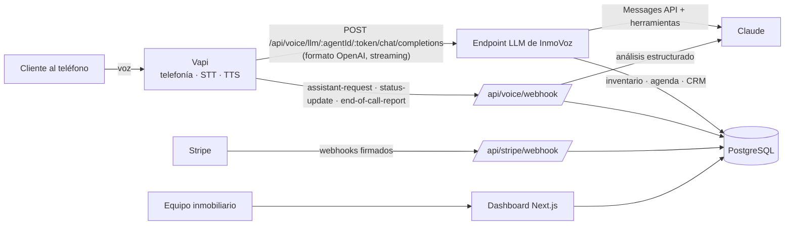

# InmoVoz · Agente inmobiliario con IA 24/7

Plataforma **SaaS lista para producción** de recepcionista inmobiliaria con IA: contesta llamadas, conversa con
compradores, vendedores y arrendatarios, **califica leads** y **agenda citas automáticamente**, las 24 horas.

Construida con **Next.js 16 (App Router) + React 19 + TypeScript**, **Claude** (Anthropic) como cerebro del agente,
**Vapi** para la voz y la telefonía, **Stripe** para las suscripciones y **PostgreSQL + Drizzle ORM** como base de datos.

---

## ✨ Funcionalidades

| | |
|---|---|
| 🤖 **Recepcionista de llamadas con IA** | Atiende llamadas entrantes al instante con voces neuronales en español (o inglés). |
| 📞 **Llamadas entrantes y salientes** | Asigna números de Vapi a tus agentes y lanza llamadas de seguimiento a leads con un clic. |
| 🏠 **Conversaciones inmobiliarias reales** | El agente consulta tu **inventario** (precio, zona, habitaciones…) y nunca inventa datos. |
| 📅 **Reserva automática de citas** | Calcula disponibilidad real (horario, duración, margen, antelación) y evita dobles reservas con bloqueo transaccional. |
| 🧠 **Conversaciones con LLM + herramientas** | Claude usa 6 herramientas: buscar inmuebles, ficha de inmueble, disponibilidad, agendar, guardar lead y pedir asesor humano. |
| 👤 **CRM de leads** | Puntuación 0-100 explicable, temperatura (frío/tibio/caliente), embudo de estados y alertas de seguimiento. |
| 🔍 **Análisis post-llamada** | Al colgar, la IA genera resumen, resultado, sentimiento, puntos clave y próximos pasos (salidas estructuradas). |
| 💳 **Suscripciones con Stripe** | Checkout, portal de cliente, webhooks firmados e idempotentes, límites de minutos y agentes por plan. |
| 🔐 **Autenticación y multi-tenancy** | Registro/login con contraseñas *scrypt*, sesiones en BD (cookies httpOnly), datos aislados por inmobiliaria. |
| ⚙️ **Agentes configurables en caliente** | Nombre, saludo, personalidad, conocimiento, preguntas de calificación, voz e idioma. Sin redesplegar. |
| 🧪 **Simulador** | Prueba el agente por chat (con dictado y lectura en voz alta del navegador) o con una llamada web real. |
| 📊 **Panel de control** | Métricas, gráfico de llamadas, próximas citas, leads prioritarios y guía de primeros pasos. |

---

## 🏗️ Arquitectura



- **Vapi** solo se encarga del audio (telefonía, voz a texto y texto a voz). El **"cerebro" es esta app**: Vapi llama a
  nuestro endpoint de *Custom LLM*, donde Claude razona y ejecuta herramientas contra la base de datos. Así la misma
  lógica sirve para el teléfono, la llamada web y el simulador de chat.
- Los asistentes de Vapi son **transitorios**: se construyen en cada llamada a partir de la configuración guardada,
  por lo que los cambios del panel aplican de inmediato.
- Para cada llamada se **congela el prompt de sistema** y el historial solo crece al final (compatible con
  *prompt caching* y con la verificación de bloques de razonamiento de los modelos actuales).

### Herramientas del agente

| Herramienta | Qué hace |
|---|---|
| `buscar_propiedades` | Filtra el inventario por operación, tipo, zona, precio y habitaciones. |
| `detalle_propiedad` | Devuelve la ficha completa de una referencia. |
| `consultar_disponibilidad` | Calcula horarios libres reales en la zona horaria de la inmobiliaria. |
| `agendar_cita` | Valida el horario dentro de una transacción con bloqueo y registra la cita y el lead. |
| `guardar_lead` | Crea/actualiza el lead (intención, presupuesto, zona, plazo, financiación) y recalcula su puntuación. |
| `solicitar_llamada_asesor` | Marca el lead para que un humano devuelva la llamada. |

---

## 🧰 Stack

- **Next.js 16.4** (App Router, Server Actions, Route Handlers, `proxy.ts`), **React 19**, **TypeScript** estricto
- **Tailwind CSS v4**, iconos **lucide-react**
- **Drizzle ORM** + **postgres.js** sobre **PostgreSQL 16** (migraciones SQL versionadas en `drizzle/`)
- **@anthropic-ai/sdk** (Claude, streaming, herramientas, salidas estructuradas con Zod)
- **Vapi** (API REST + `@vapi-ai/web` para llamadas desde el navegador)
- **Stripe** (Checkout, Billing Portal, webhooks)
- **Zod** para validación, **Vitest** para pruebas

---

## 🚀 Puesta en marcha local

Requisitos: **Node.js 20.9+** (recomendado 22) y **Docker** (o un PostgreSQL propio).

```bash
git clone https://github.com/hamstersoftwarecol/agente-inmobiliario-con-IA.git
cd agente-inmobiliario-con-IA
npm install
cp .env.example .env          # completa al menos DATABASE_URL y ANTHROPIC_API_KEY
docker compose up -d          # PostgreSQL en localhost:5432
npm run db:migrate            # crea las tablas
npm run db:seed               # datos demo (opcional)
npm run dev                   # http://localhost:3000
```

Con el seed puedes entrar con **demo@inmovoz.com / demo12345** (inmobiliaria demo con inmuebles, leads, llamadas y citas).

> Sin claves de Vapi ni Stripe la app funciona igual: el simulador de chat usa Claude directamente y el plan de
> prueba (14 días, 30 minutos) se aplica automáticamente.

---

## 🔑 Variables de entorno

| Variable | Obligatoria | Descripción |
|---|---|---|
| `APP_URL` | ✅ | URL pública sin `/` final. Vapi y Stripe la usan para los webhooks. |
| `DATABASE_URL` | ✅ | Cadena de conexión de PostgreSQL. |
| `ANTHROPIC_API_KEY` | ✅ | Clave de la API de Claude. |
| `ANTHROPIC_MODEL` | | Modelo del agente y del análisis. Por defecto `claude-opus-5-5`. |
| `ANTHROPIC_VOICE_MODEL` | | Modelo solo para voz, si quieres priorizar latencia (p. ej. `claude-sonnet-5-5` o `claude-haiku-5-5`). |
| `AI_CHAT_EFFORT` / `AI_ANALYSIS_EFFORT` | | Esfuerzo de razonamiento (`low`…`max`). Por defecto `low` para conversación y `medium` para análisis. |
| `VAPI_API_KEY` | Voz | Clave **privada** de Vapi (llamadas salientes). |
| `VAPI_WEBHOOK_SECRET` | Voz | Secreto propio (`openssl rand -hex 32`): firma las URLs del LLM/webhooks y autentica los números de teléfono. |
| `NEXT_PUBLIC_VAPI_PUBLIC_KEY` | | Clave **pública** de Vapi para la llamada web desde el navegador. |
| `STRIPE_SECRET_KEY` | Pagos | Clave secreta de Stripe. |
| `STRIPE_WEBHOOK_SECRET` | Pagos | Secreto de firma del endpoint de webhooks. |
| `STRIPE_PRICE_STARTER` / `_PRO` / `_AGENCY` | Pagos | IDs de precios recurrentes mensuales. |
| `TRIAL_DAYS` | | Días de prueba gratuita (14 por defecto). |

`GET /api/health` muestra el estado de la base de datos y de cada integración.

---

## 📞 Configurar la voz con Vapi

1. Crea una cuenta en [vapi.ai](https://vapi.ai) y copia la **Private Key** (`VAPI_API_KEY`) y la **Public Key**
   (`NEXT_PUBLIC_VAPI_PUBLIC_KEY`). Define tu propio `VAPI_WEBHOOK_SECRET`.
2. Publica la app en una URL accesible desde internet (`APP_URL`). En local: `ngrok http 3000`.
3. Compra o importa (Twilio, Vonage, SIP) un número en Vapi y, en su configuración:
   - **No** le asignes asistente (InmoVoz lo envía dinámicamente con `assistant-request`).
   - **Server URL:** `https://TU_DOMINIO/api/voice/webhook`
   - **Server URL Secret:** el valor de `VAPI_WEBHOOK_SECRET` (llega en la cabecera `x-vapi-secret`).
4. En **Dashboard → Agentes IA → Configurar**, pega el **Phone Number ID** del número y guarda.
5. ¡Llama al número! Para llamadas salientes ve a **Llamadas → Nueva llamada saliente** (el lead necesita teléfono en
   formato internacional, p. ej. `+573001234567`).

El asistente usa transcripción de Deepgram y voces neuronales de Azure por defecto (`es-CO-SalomeNeural`); puedes
cambiar proveedor y voz por agente.

## 💳 Configurar Stripe

1. Crea tres productos con precio **recurrente mensual** (Starter 49 USD, Pro 149 USD, Agency 399 USD) y copia sus IDs.
2. Crea un endpoint de webhook a `https://TU_DOMINIO/api/stripe/webhook` con los eventos
   `checkout.session.completed` y `customer.subscription.created|updated|deleted|paused|resumed`.
3. Activa el **Customer Portal** en Stripe (cambio de plan y cancelación).
4. En local: `stripe listen --forward-to localhost:3000/api/stripe/webhook`.

Los límites de cada plan (minutos de voz y agentes) están en `src/lib/plans.ts`.

---

## 🗂️ Estructura del proyecto

```
src/
├── app/
│   ├── page.tsx                      # Landing con precios
│   ├── (auth)/                       # Login, registro y acciones de sesión
│   ├── dashboard/                    # Panel protegido
│   │   ├── llamadas/  leads/  citas/  propiedades/
│   │   ├── agentes/[id]/probar/      # Simulador de chat + llamada web
│   │   ├── facturacion/  configuracion/
│   └── api/
│       ├── voice/llm/[agentId]/[token]/chat/completions/  # Custom LLM para Vapi (Claude)
│       ├── voice/webhook/            # Eventos de Vapi
│       ├── stripe/webhook/           # Eventos de Stripe
│       └── health/
├── db/                               # Esquema Drizzle y conexión
├── lib/
│   ├── ai/                           # Prompt, herramientas, bucle del agente, análisis
│   ├── booking/                      # Motor de disponibilidad (zonas horarias)
│   ├── voice/                        # Vapi: asistente, firmas, eventos, compatibilidad OpenAI
│   ├── billing/                      # Stripe
│   ├── services/                     # Leads, agenda, llamadas, consumo
│   └── auth/                         # Contraseñas, sesiones, rate limit
├── components/                       # UI
└── proxy.ts                          # Redirección optimista de rutas protegidas
drizzle/                              # Migraciones SQL
scripts/                              # migrate.ts y seed.ts
```

---

## 🧪 Calidad

```bash
npm run lint         # ESLint (config de Next.js)
npm run typecheck    # TypeScript (ejecuta antes `npx next typegen` en un clon limpio)
npm test             # Vitest: unitarias + integración del agente contra PostgreSQL
npm run build        # Build de producción
```

La prueba de integración (`src/lib/ai/agent.integration.test.ts`) ejecuta el bucle del agente contra una base de datos
real con Claude simulado: busca inventario, consulta disponibilidad, agenda una cita, crea el lead y verifica que no
se puede reservar dos veces el mismo horario. Se omite si no hay `DATABASE_URL`. El workflow de GitHub Actions
(`.github/workflows/ci.yml`) corre todo con un PostgreSQL de servicio.

---

## ☁️ Despliegue

- **Vercel / Railway / Render / Fly.io:** configura las variables de entorno, ejecuta `npm run db:migrate` en cada
  release y apunta `APP_URL` al dominio final. Usa un PostgreSQL gestionado (Neon, Supabase, RDS…). Con poolers en modo
  *transaction* (PgBouncer) define `DATABASE_DISABLE_PREPARE=true`.
- **Docker:** `docker build -t inmovoz . && docker run -p 3000:3000 --env-file .env inmovoz` (aplica migraciones al arrancar).

### Checklist de producción

- [ ] `APP_URL` con HTTPS y dominio definitivo; webhooks de Vapi y Stripe apuntando a él.
- [ ] `VAPI_WEBHOOK_SECRET` largo y aleatorio. Rotarlo invalida todas las URLs firmadas.
- [ ] El limitador de intentos de login está en memoria: con varias réplicas, muévelo a Redis/Upstash.
- [ ] Backups automáticos de PostgreSQL.
- [ ] Revisar el texto legal de grabación de llamadas y tratamiento de datos de tu país (p. ej. Ley 1581 en Colombia).

## 🛡️ Seguridad

- Contraseñas con `scrypt`; sesiones aleatorias de 256 bits guardadas como hash SHA-256; cookies `httpOnly` + `SameSite=Lax`.
- Todas las consultas filtran por `organization_id` (multi-tenant) y cada Server Action vuelve a validar la sesión.
- URLs de Vapi firmadas con HMAC por agente; los números de teléfono se autentican con `x-vapi-secret`.
- Webhooks de Stripe verificados por firma e idempotentes (`webhook_events`).
- Cabeceras de seguridad (HSTS, `X-Frame-Options`, `nosniff`, `Permissions-Policy`).

## 🗺️ Ideas para seguir

Recordatorios automáticos de citas por SMS/WhatsApp, sincronización con Google Calendar, transferencia en vivo a un
asesor, campañas salientes programadas, invitación de miembros del equipo y portal público de inmuebles.

---

Hecho con ❤️ para inmobiliarias que no quieren volver a perder una llamada.
